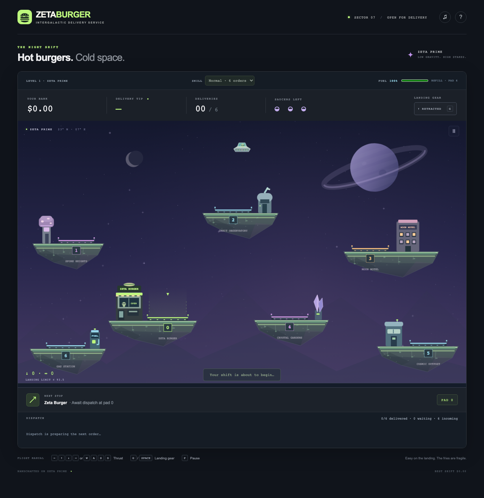
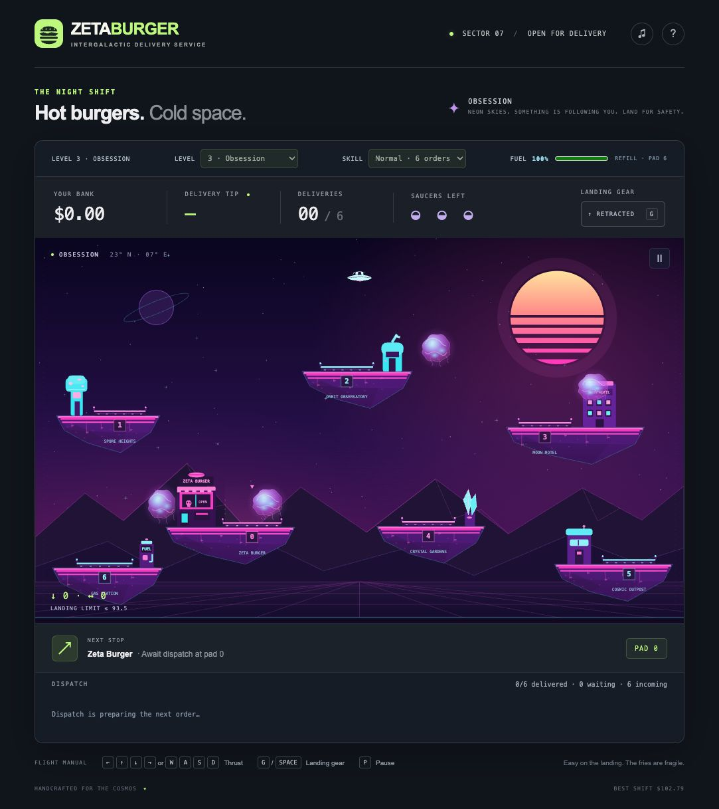
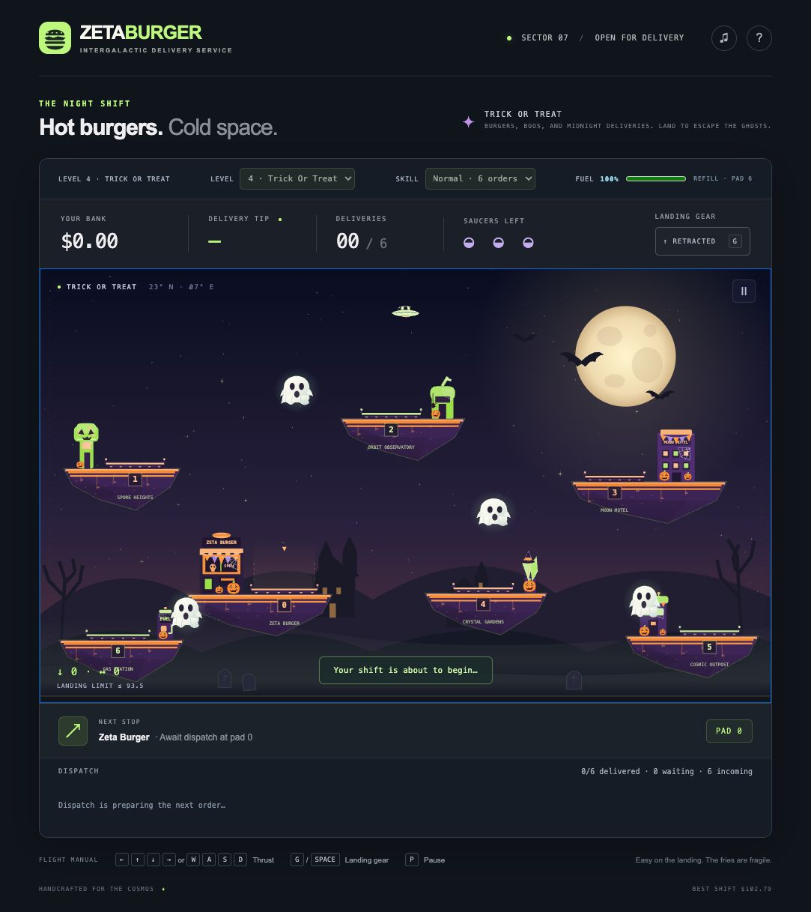
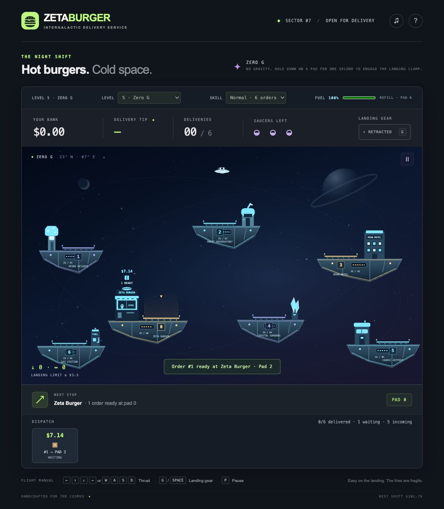
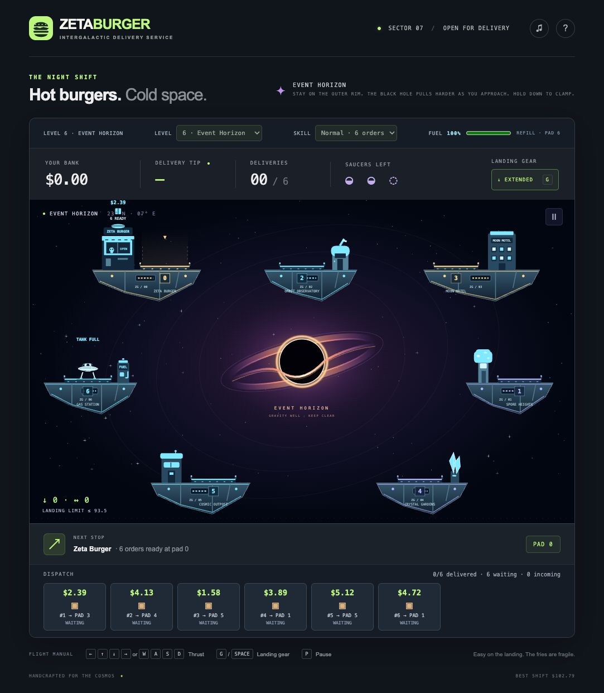
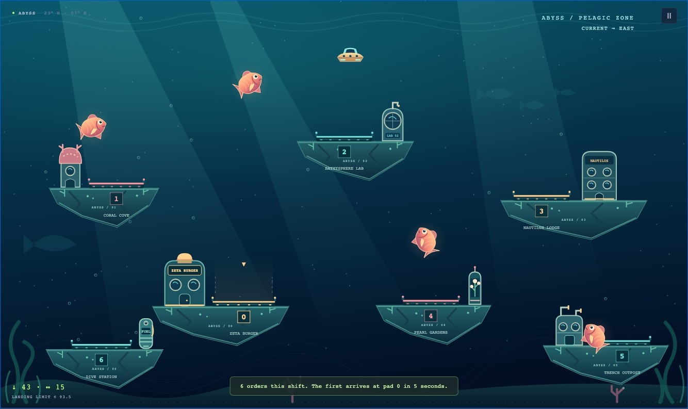
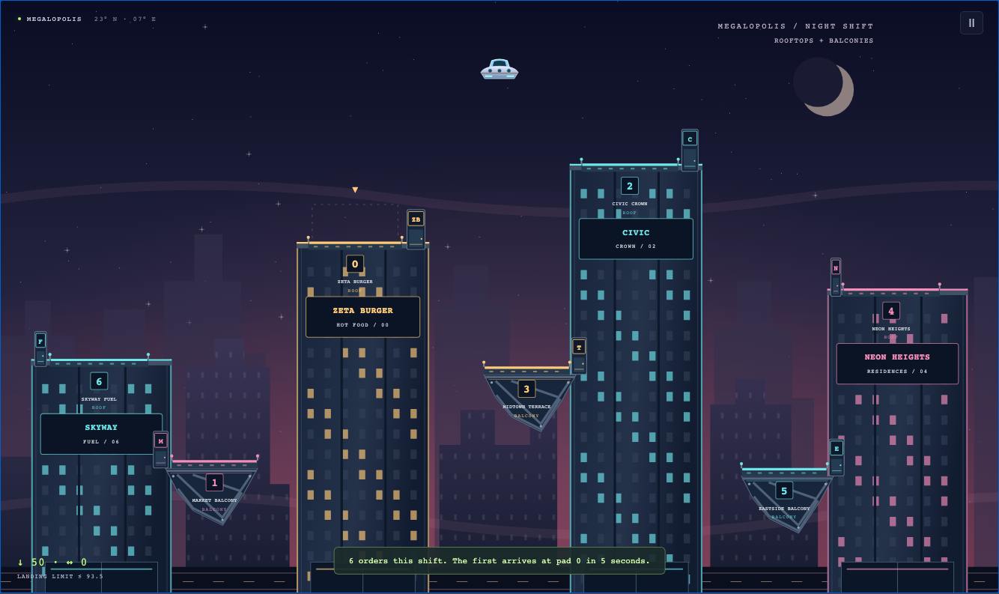

# Zeta Burger

Hot burgers. Cold space. A side-view arcade game about flying a saucer on an alien world's night shift. Inspired by the flight and landing mechanics of Space Taxi, with original art and a burger delivery loop.



## Run locally

Uses Node.js 24 LTS and npm.

```sh
npm install
npm run dev
```

Open **http://localhost:5173**. The server watches TypeScript and public assets; refresh the browser after changes. Set `PORT=8080 npm run dev` to use another port. The development server listens on all interfaces so a phone on the same network can open `http://YOUR_COMPUTER_LAN_IP:5173` (subject to your firewall).

```sh
npm run typecheck   # Strict TypeScript checks
npm test            # Build and run physics, scoring, and complete flight-route tests
npm run build       # Compile a static site into dist/
```

Serve `dist/` with any static HTTP host, at the domain root or in a subdirectory such as `/games/zeta-burger/`. The game uses relative asset URLs. No server APIs, remote fonts, or runtime dependencies are needed. TypeScript is the only development dependency, approved for compilation and type checking.

## Deploy to Heroku

The deployed app is **zeta-burger**:
https://zeta-burger-f207cc267fb2.herokuapp.com/.

Heroku installs the build dependencies and runs `npm run build` during deployment.
The `Procfile` runs `npm start`, which serves only the built `dist/` files using
Node's HTTP server on `0.0.0.0:$PORT`. No database or add-ons are required.

### Automatic deployments

Push to **any branch** on GitHub to run the
[Deploy to Heroku workflow](https://github.com/mwilber/zeta-burger/actions/workflows/deploy-heroku.yml).
It installs dependencies, checks types, builds the site, and uploads that push's
exact commit to Heroku's build API. There is no direct Git push to Heroku.
Tag pushes and branch deletions do not deploy.

All branches share one app and one deployment queue. Newer deployment requests
supersede queued older requests; requests already building on Heroku finish
before the next deployment starts. "Latest" means the latest push/deployment
request, regardless of the commit's author date or branch. A failing check/build
leaves the previous working release online. GitHub queues up to 100 pending
requests; workflow skip directives such as `[skip ci]` also skip deployment.

The workflow must exist in a branch for pushes to that branch to trigger it.
Merge or cherry-pick this setup into older branches before expecting automatic
deployments from them.

### Manually deploy a branch

Open **Actions → Deploy to Heroku → Run workflow**. Leave **Use workflow from**
set to `master`, enter the desired branch in **Branch to deploy**, and run it.
The requested branch does not need to contain the workflow or deployment script;
deployment tooling comes from the workflow revision. It must support the project's
normal npm build/typecheck commands. The branch tip is resolved when the job
starts. A later push to any branch takes over again.

```sh
gh workflow run deploy-heroku.yml --ref master -f branch=YOUR-BRANCH
```

The workflow is available for manual runs once it is on the default branch
(`master`). The repository secret `HEROKU_API_KEY` holds a dedicated, non-expiring
Heroku OAuth authorization named `GitHub Actions: mwilber/zeta-burger`, with
the `global` scope for Heroku's build service. Revoke that authorization to disable
its access; replace the GitHub secret when rotating it. The app name is configured
in the workflow as `HEROKU_APP_NAME`.

To preview the production server locally, run `npm run build && npm start` and
open http://localhost:5173 (or set `PORT` to another port).

## Play

- **Arrow keys or W/A/S/D:** thrust up, down, left, and right. **Down Arrow or S** accelerates descent; Up and Down held together cancel vertical thrust and consume no vertical fuel. Downward thrust works in the air with either gear setting; while docked, it leaves the saucer on the pad. There is no rotation or pitch control.
- **G or Space:** extend/retract landing gear. The first upward thrust after landing automatically retracts it. Extended gear disables sideways thrust. All existing momentum continues; use opposite thrust to brake before extending gear.
- **P or Escape:** pause/resume. Switching tabs or losing focus automatically pauses the game.
- **Enter:** start a shift or replay after game over.
- **Touch:** hold the on-screen arrows; tap GEAR. Multiple simultaneous touches are supported. Landscape offers a larger flight field with controls beside it.
- **♫:** enable or mute synthesized arcade sound. Sound begins enabled and is unlocked by Start or the sound button.
- **?:** open the flight manual; the active shift pauses while it is open.

The soundscape includes a happy victory jingle for delivering all orders and a sad jingle for running out of saucers or tips. Vertical (up or down) and sideways thrust each play an independent warbling saucer sound, so both can overlap; gear lock, empty fuel, and releasing controls silence the corresponding thruster. Close-call landings stutter in time with the visual hops. Crashes use a noisy impact and falling rumble, and a rising chime announces each order ready for pickup. Pause and mute stop active sounds; the final loss jingle follows the crash animation.

Start floating at the **top center of the play field**, with no initial drift and gear retracted. Choose a skill setting before starting. Starting or replaying a shift closes the dialog and plays a **short musical jingle during a three-second pause** before flight, fuel use, arrivals, and tip clocks begin. Pause, Help, and switching away freeze the start delay and stop the jingle; resuming continues the remaining melody. The sound button mutes the jingle along with the other effects. Then fly to **pad 0** at the restaurant. Touch down gently with gear extended and remain docked for 0.8 seconds to load the oldest waiting order. You carry one order at a time. The HUD and a beacon identify its numbered destination. Land there to unload, collect the current signed tip, and return to the restaurant for another order.

Each level begins with a fixed schedule of orders. The first order always arrives **five seconds after the level starts**, with its tip countdown beginning on arrival. Later orders arrive at random intervals measured from the previous arrival, even while another order is aboard. Every order starts its own **$5–$10** tip countdown on arrival; waiting and onboard orders lose tip value independently. Current tips hover above the package icons in flight and at the restaurant; the dispatch strip shows every active order. Negative tips subtract from your bank on delivery.

| Skill | Total orders | Arrival interval | Tip decrease |
| --- | --- | --- | --- |
| Casual | 4 | 12–22 seconds | $0.06/second |
| Normal | 6 | 8–16 seconds | $0.08/second |
| Expert | 8 | 5–10 seconds | $0.12/second |
| Tester | 1 | First order at 5 seconds; no later arrivals | $0.08/second |

The level ends when all orders are delivered, or when all scheduled orders have arrived and **every undelivered tip would leave your bank below zero** (`bank + tip < 0`). Your savings cover negative tips: with $9.38 in the bank, a tip of −$9.38 is still affordable; a lower tip is not. The shift continues while any remaining delivery is affordable or orders are still incoming. Losing the shift displays **“You’re fired!”**. The result screen identifies the end reason and shows delivered/total progress. **Level 5 · Zero G**, **level 4 · Trick Or Treat**, **level 3 · Obsession**, **level 2 · Meteor Shower**, and **level 1 · Luna** are available in that development play order. Choose a level before starting, and completing all deliveries automatically starts the next configured level without a result dialog. The result screen appears after the final configured level or a failed shift.

Fuel starts at **100%**. Upward or downward thrust consumes **1.8%/second** and sideways thrust **0.9%/second**; using both consumes both rates. Coasting and locked sideways controls use no fuel. At zero fuel, gravity and momentum continue but thrust stops. Land on **pad 6** to refill for free at **25%/second**. Below 25%, the HUD warns you and the gas station lights up. Refueling takes time while all order tips continue falling.

Three saucers are available per shift. A crash costs one life and respawns you at the gas station with a full tank after 1.5 seconds; your onboard order survives, and all tip clocks and arrivals continue during respawn. Losing all three saucers ends the shift after the final crash animation plays for 1.5 seconds; shift resources freeze at the final impact, and the end-game dialog appears when the explosion finishes. Pause freezes arrivals, tips, fuel, and flight. Best bank is saved locally when browser storage is available.

Landings require both feet to be completely inside the pad, a downward speed at or below **93.5 world units/second**, and sideways speed at or below **38.5**. The speed readout turns pink when unsafe. A surviving touchdown within 25% of either crash speed makes the saucer bounce four times in **0.8 seconds**, with a close-call message. These visual hops leave the ship docked; thrust or gear retraction cancels them. Hull contact, gear contact against pad sides/undersides, buildings, islands, and the world boundary are fatal. The stars, distant planets, and atmospheric mountains are background scenery.

## Project layout

| File | Purpose |
| --- | --- |
| `src/engine.ts` | Browser-independent physics, landing, lives, orders, signed tips, and game state |
| `src/level-config.ts` | Editable level numbers, names, gravity, themes, pad locations/motion/counts, and station roles |
| `src/levels.ts` | Config validation, generated levels, asset filenames, and skill settings |
| `src/world.ts` | Geometry generated from pad configuration and convex polygon collision |
| `src/renderer.ts` | SVG scene assembly, animation, and optional asset overrides |
| `src/main.ts` | Fixed-step render loop, keyboard/multitouch input, HUD, pause, help, and local best bank |
| `src/audio.ts` | Optional sound made with the browser's Web Audio API |
| `public/index.html`, `public/style.css` | Responsive game shell and accessible controls |
| `public/assets/*.svg` | Default scenery, saucer, buildings, islands, pads, and effect templates |
| `public/assets/manifest-1.json` | Optional custom image overrides |
| `tests/engine.test.mjs` | Flight, collision, landing, delivery, scoring, pause, and life-cycle checks |
| `tests/falling-obstacles.test.mjs` | Falling obstacle spawning, caps, continuous collisions, explosions, and lifecycle checks |
| `tests/seekers.test.mjs` | Seeker pursuit, random drift, landed immunity, collisions, and lifecycle checks |
| `tests/routes.test.mjs` | Actual control-driven flights from the top center to every destination and back, without teleporting |
| `scripts/dev.mjs` | Development server and TypeScript watch process using Node built-ins |

The simulation runs at **120 Hz** independent of rendering rate. Long frame gaps are discarded to avoid catching up across obstacles. The physics has gravity and independent thrusters, with no artificial horizontal drag. Gear changes never reset velocity. Holding left or right with gear retracted tips the saucer toward 25 degrees in that direction; releasing the control immediately starts its return upright, even while coasting. Banking responds three times faster than the original velocity-based tilt; the hull and gear collision shapes remain upright. Expanding energy rings replace rocket exhaust. Touch inputs use pointer capture and clear on release/cancellation; keyboard and touch inputs can coexist.

## Add designer assets

The default artwork lives in editable SVG files in `public/assets/`. The playfield uses SVG rendering; there are no built-in Canvas drawing calls. Edit the SVG files directly to change the defaults, or use the optional manifest to replace the background, saucer hull, and buildings with PNG, WebP, or SVG images.

| Asset | Purpose |
| --- | --- |
| `background-1.svg` | Sky gradients, planets, mountains, and world boundary scenery |
| `saucer-1.svg` | Saucer hull and pilot, fitted to the 48 × 25 hull box at `(-24, -17)` |
| `restaurant-1.svg`, `gas-1.svg`, `mushroom-1.svg`, `observatory-1.svg`, `motel-1.svg`, `crystal-1.svg`, `outpost-1.svg` | Buildings, in local coordinates matching their rectangles in `src/level-config.ts` |
| `island-0-1.svg` through `island-6-1.svg` | Island art, relative to each island's upper-left vertex |
| `pad-N-1.svg`, `pad-N-active-1.svg` | Idle and highlighted pads, relative to each pad's upper-left corner |
| `falling-obstacle-2.svg` | Meteor Shower’s falling obstacle body and trail; optional per level |
| `effects-1.svg` | Star, gear, thrust, package, service, particle, and crash-message templates |

[View the original Canvas and new SVG artwork side by side](docs/screenshots/svg-art-comparison.png).

SVG artboards are mapped into fixed game rectangles. Both the original negative-origin viewBoxes and Adobe Illustrator exports starting at `0 0` work without manual coordinate edits. For example, `saucer-1.svg` may use either `-24 -17 48 25` or `0 0 48 25`: its artboard still fits the hull box with upper-left corner `(-24, -17)` relative to the ship. Buildings, background, islands, pads, and effect templates receive the same normalization; animation coordinates are converted to the exported artwork's local units. Root presentation attributes and nested layer transforms are preserved.

In Illustrator, keep the existing artboard and export the full artboard rather than cropping to the artwork bounds. Padding and artwork placement inside the artboard affect alignment; the loader fits the artboard rather than centering the visible paths. The saucer's ship origin corresponds to `(24, 17)` on a `0 0 48 25` artboard. Export dimensions may change, but keep the artboard's aspect ratio to avoid stretching. Animated templates still need the IDs, `data-*` hooks, and editable SVG element types described below.

Keep the `data-*` hooks in the assets and the template IDs in `effects-1.svg`; the renderer uses them for twinkling, vines, beacon movement, energy rings, and changing text. Keep `background-1.svg`'s `data-sky` group to place stars between the sky and planetary scenery. SVG gradients and clipping IDs are namespaced when cloned, so repeated artwork does not conflict.

To use manifest overrides, put replacement images in `public/assets/` and edit `public/assets/manifest-1.json`:

```json
{
  "background": "./assets/alien-sky.webp",
  "saucer": "./assets/saucer-1.svg",
  "buildings": {
    "restaurant": "./assets/restaurant-1.svg",
    "gas": "./assets/gas-station.svg",
    "mushroom": "./assets/spore-house.svg",
    "observatory": "./assets/observatory-1.svg",
    "motel": "./assets/motel-1.svg",
    "crystal": "./assets/crystals.svg",
    "outpost": "./assets/outpost-1.svg"
  }
}
```

Image paths in the manifest resolve relative to the game page. Omitted or failed override images retain the default SVG artwork. The default SVG files are required assets and must be deployed with the game. The background fits the **1280 × 760** world and renders behind all interactive objects. A transparent saucer image fits the **48 × 25** hull box, with its upper-left corner at `(ship.x − 24, ship.y − 17)`; gear, energy waves, and order indicators remain dynamic SVG elements from `effects-1.svg`. Keep the hull silhouette consistent with `shipBody()` in `src/engine.ts`. Building images fit their rectangles from `src/level-config.ts`. If a designer changes a solid silhouette, update its collision geometry too. Keep island outlines in `island-N-1.svg` consistent with the vertices in `src/level-config.ts` so the visible terrain matches collision. If pad dimensions or labels change, update both pad SVG states as well.

## Level editor

Click the **✎** button beside Sound to open the level editor. It enters design mode and freezes the entire world, including moving stations, hazards, ship physics, animations, and order timers. The standalone Design Mode button still runs the animated world as before.

Choose an existing level or **New blank level**. Every draft supports changing the total platform count, dragging a complete station, entering precise **X / Y** coordinates, and toggling the fuel station. The count includes the restaurant and fuel station. Existing levels keep their restaurant and at least one delivery destination; use the fuel checkbox to remove the fuel station. Removing it also removes its building, island, and collisions. Without a fuel station, replacement ships dock at the restaurant with a full tank, and landing there does not refuel.

New blank levels also support a background from any existing level, any existing platform artwork, the city's tower barrier assets, meteors, a black hole, cloud/ghost/fish seekers, an ocean current, gravity in world units/second², and a thrust multiplier (1 is full power; 0.3 is Zero G's reduced power). The first platform added is the restaurant; subsequent platforms are delivery destinations. Barriers can be dragged or positioned with X / Y and removed. Static hazard samples show what is enabled while the world stays frozen. Platforms and barrier artwork can be mixed across themes. Background, platform, and barrier artwork use thumbnail-grid pickers, with a preview of the current selection. Clicking a platform or barrier thumbnail adds it immediately; choosing the selected item again adds another copy. Their popups fit the viewport and scroll through larger collections. Use the arrow keys to browse, Enter or Space to choose, and Escape or a click outside to dismiss.

**Done** closes the toolbar and restarts the selected playable draft, restoring the previous design-mode setting. An incomplete blank draft returns play to the first configured level and remains available in the editor's level selector. Drafts survive switching levels and closing the toolbar within the session, but **reload discards them**.

**Export JavaScript** opens a read-only textarea with a **Copy JavaScript** button. An export requires a restaurant and at least one delivery platform. For an existing level, replace its object in `LEVEL_CONFIG` in `src/level-config.ts`, keeping its number, ID, and position. For a new level, prepend the exported object to follow the newest-first development order. Exports include an `assets` map of existing SVG basenames where needed, so additional platforms and mixed themes work without creating or renaming SVG files. New levels get unique numbers and IDs; existing level identities and filenames stay stable.

## Level configuration

The **order of entries in `LEVEL_CONFIG` is the play order**, including the initial level, level selector, and automatic level progression. Numbers do not need to be consecutive or ascending: entries numbered `8, 1, 4` play in that order. During development, treat levels as a **LIFO stack (newest first)**: prepend each new level so it becomes the starting level. The current play order is **Blizzard → Srormfront → Grotto → Freeman → Megalopolis → Abyss → Event Horizon → Zero G → Trick Or Treat → Obsession → Meteor Shower → Luna**. Keep each level's `number` and `id` unchanged so its graphics filenames and identity stay the same.

Edit `src/level-config.ts` to customize levels. Luna is level **1**, with the original seven pads and artwork. Each level has a unique `number` and `id`, a display `name`, a `theme` tagline, a nonnegative `gravity` acceleration (world units/second²), a ship `start` position, a numeric `fallingObstacleLimit`, a numeric `seekerCount`, a restaurant pad ID, a gas station pad ID (`null` disables the station), and a `pads` list. The list length is the total number of pads: add or remove entries to change it. Pad IDs may be nonconsecutive. All pads except the restaurant and gas station become delivery destinations automatically; each level requires at least one delivery destination.

A pad's `x` and `y` locate the upper-left corner of its landing surface in the **1280 × 760** world. Its island and building `x` values are offsets from the pad, and building `height` positions its roof above the surface. Changing only the pad's `x`/`y` moves its island, building, graphics, and collision geometry together. Edit `width`, island dimensions, or building dimensions to resize a station. Add optional `motion: { x: 18, y: 12, period: 20 }` for a gentle orbital drift: `x`/`y` are amplitudes in world units and `period` is seconds. The whole station moves together, including its landing surface, scenery, collisions, and docked ship. Motion follows gameplay time and freezes on pause, countdown, and game over. Keep the artwork aligned with these generated collision shapes. Configuration errors such as duplicate pad IDs or missing station roles fail with a level-specific message.

```ts
// Example pad entry (coordinates are world units):
{
  id: 0, name: 'Zeta Burger', x: 370, y: 560,
  width: 116, color: '#bdf77d',
  island: { x: -112, width: 254 },
  building: { x: -90, width: 76, height: 95, kind: 'restaurant' }
}
```

Every gameplay graphic appends `-<level number>` to its original name, before the extension. For level 2, supply `background-2.svg`, `saucer-2.svg`, `effects-2.svg`, each configured building such as `restaurant-2.svg`, and `island-<pad ID>-2.svg`, `pad-<pad ID>-2.svg`, `pad-<pad ID>-active-2.svg` for each pad. The loader derives required assets from that level's pad list; no renderer edits are needed for more pads, different IDs, or new building kinds. `icon.svg` stays shared for the page's branding. Optional image overrides use `manifest-<level number>.json` with the same format shown above; paths in the manifest are used exactly as written.

To add a level during development, prepend its configuration and add its graphics. The level selector appears when multiple levels exist, and completing all deliveries automatically transitions to the next configured level. Each level starts a fresh shift with the same skill setting and the usual three-second start countdown. Your signed bank balance carries into the next level, and new delivery tips add to that running total. Starting or replaying a game resets the bank to zero. There is no dialog or confirmation between completed levels. Replay remains available on wins and losses. All scenery, ships, stations, and effects reload when switching levels; failed required art prevents starting that shift. Reload the browser after config or asset edits when using the dev server, or rebuild before deploying. Skill settings live in `SKILLS` and fuel tuning in `FUEL`.

### Falling obstacles

Meteor Shower uses Luna's seven-pad layout with cool grey artwork and introduces falling obstacles, currently skinned as meteors. Set `fallingObstacleLimit` on any level: **0 disables them**, and a positive integer is the maximum active count. Meteor Shower starts at **4**. Obstacles enter from the top on fixed straight paths, with random downward angles (up to 35 degrees either side of vertical), speeds, sizes, and staggered arrivals. They keep falling during replacement delays and freeze during countdown, pause, the final ship explosion, and game over. Restarting or changing levels clears them.

An obstacle explodes at its first contact with a pad, island, building, world side or floor, another falling obstacle, or the player's hull/extended gear. Two colliding obstacles both explode; a ship collision explodes both ship and obstacle and costs one life. Docked ships remain vulnerable. Static scenery is never damaged, moved, or removed. Impacts reuse the ship's particle explosion and sound, without displaying the ship-loss message or interrupting thrust on terrain-only impacts. Continuous collision checks prevent fast obstacles or ships from passing through each other or thin pads between updates.

For every enabled level, supply `public/assets/falling-obstacle-<number>.svg`. Its artboard is mapped to `-24 -76 48 100`, with a solid octagonal body of radius **16** centered at `(0, 0)`; the upper portion is a decorative trail. The renderer scales the body to each obstacle's collision radius and aligns the trail to its flight direction. Edit this SVG to reskin falling obstacles in another theme. Spawning and flight tuning live in `FALLING_OBSTACLES` in `src/engine.ts`.

### Seekers / Obsession

**Obsession (level 3)** uses a synthwave palette: violet skies, a striped pink sun, neon cyan/pink stations, and a perspective grid. It introduces four animated, amorphous cloud **seekers**. Set `seekerCount` to a nonnegative integer on any level (0 disables them), and supply `seeker-<number>.svg`. No falling obstacles are enabled on Obsession.



Seekers pass through pads, islands, buildings, falling obstacles, and one another. While the ship is in flight, they steer toward it with eased turns and a jellyfish-like pulse/glide. While the ship is landed, it is completely immune to seekers and they drift in random directions, choosing a new heading every 2–4 seconds. Taking off or retracting the gear removes this protection. Airborne hull or extended-gear contact costs a life and uses the normal crash/respawn cycle; seekers survive contact.

The ship has no speed cap, so seekers use a fixed **30 world units/second** average target, roughly one quarter of a typical 120-unit/second flight speed, rather than scaling with the ship's instantaneous velocity. Tuning lives in `SEEKERS` in `src/engine.ts`. They stay within the flight field and begin at least 200 units from the initial ship position. Replay and level changes recreate their population. Countdown, pause, game over, and the final crash explosion freeze their movement and animation; they continue wandering during other replacement delays. The renderer animates the SVG's vapor wisps and breathing from simulation time and respects reduced-motion preferences for the decorative movement.

### Trick Or Treat

**Trick Or Treat (level 4)** is a Halloween reskin of Obsession with the same station layout, four seekers, movement, collisions, and landed immunity. The seekers appear as animated white-sheet ghosts with dark eyes and rippling hems. Buildings wear jack-o’-lanterns, cobwebs, bunting, and other Halloween decorations. Amber lights, spectral green accents, a full moon, bats, and distant haunted scenery replace the synthwave setting. All artwork uses the `-4.svg` suffix; progression continues to Obsession after completing the level.




### Zero G



**Zero G (level 5)** follows Event Horizon in the development play order. All seven stations float in deep space and gently drift along small orbital paths. There are no seekers or falling obstacles. Its `gravity: 0` means the ship keeps its horizontal and vertical momentum until you apply opposite thrust. Its `thrustScale: .3` reduces upward, downward, and sideways acceleration by 70%, with the usual fuel consumption. The existing four levels each retain `gravity: 100`, full thrust power, and their original landing behavior.

Match a pad's motion and descend gently with gear extended. **Hold Down for 250 ms after touchdown** to press the ship onto the pad and engage its landing clamp. This burns the normal downward-thrust fuel; releasing early (or exhausting fuel) lets the ship rebound and float away, resetting docking progress. Pickup and delivery wait until the clamp engages. The ship shows a progress bar and a **HOLD ↓ TO CLAMP** prompt while settling.

Once clamped, release Down: the ship rides with the station without using fuel until upward thrust or gear retraction releases it. Takeoff inherits the station's velocity. Landing speed limits are measured relative to the moving pad. Replacement saucers arrive already clamped at the moving gas station, so recovery and refueling remain safe. Level 5's `-5.svg` assets depict metal station modules against an open starfield; completing it advances to Trick Or Treat.

### Event Horizon



**Event Horizon (level 6)** follows Abyss in the development play order. Seven stationary stations surround a black hole at the center of the screen. There is no uniform downward gravity: the hole pulls airborne ships inward from every direction, including when fuel is empty or gear is extended. The inverse-square pull increases as distance shrinks and is capped near the center. Full-strength thrusters let you brake and navigate around the outer rim. Crossing the bright event horizon with the hull or landing gear costs a life; continuous collision checks also catch fast crossings.

Landing on any pad immediately stops the black hole’s pull, without holding Down or burning fuel, even with an empty tank. Pickup and delivery take 250 ms. Upward thrust or gear retraction releases the ship and restores the pull. Replacement ships arrive safely docked at the gas station. There are no seekers or falling obstacles. Completing the level advances to Zero G.

Configure the well with optional `blackHole: { x, y, radius, strength, maxAcceleration }` in a level entry. Positions and horizon radius use world units; acceleration is `min(maxAcceleration, strength / distance²)` toward the center. Supply `black-hole-<number>.svg` on a `-208 -156 416 312` artboard with a horizon radius of 52; the renderer scales the art to the configured radius. Event Horizon's station and background assets use the stable `-6.svg` suffix.


### Abyss



**Abyss (level 7)** follows Megalopolis in the development play order, underwater in the deep ocean. Seven reef stations drift together in a reversing horizontal current, with pressure-sealed habitats, coral, light shafts, bubbles, and an ocean-colored delivery submersible. The current indicator shows the flow direction. Gravity is reduced to **35**, so the ship slowly sinks; thrusters retain full power.

Configure flow with optional `current: { speed, period, drag }`: peak water speed in world units/second, cycle length in seconds, and the ship’s horizontal drag response in 1/second. Stations follow the integrated flow, moving their artwork and all collision shapes together. Water drag carries airborne ships even with empty fuel or extended gear. Brake with sideways thrust before extending the landing gear and match the station’s velocity. Docking immediately secures the ship, which rides the current for free; pickup and delivery use the normal 0.8-second dwell. Upward thrust or gear retraction releases it.

Four animated fish use the generic seeker system, pursuing an airborne ship and passing through scenery and each other. Landed ships are immune; fish wander while the ship is docked. Fish and currents freeze during countdown, pause, the final explosion, and game over, and reset on replay or level changes. All Abyss artwork uses the stable `-7.svg` suffix.


### Megalopolis



**Megalopolis (level 8)** follows Freeman in the development play order. Four illuminated skyscrapers rise from street level, forming solid barriers across the city. Seven numbered pads serve the buildings: four on rooftops and three on projecting side balconies. Climb into the open lane above the skyline before crossing town, then descend along the destination's clear approach corridor. Tower walls and unmarked roof surfaces are fatal. Gravity is **100**, thrusters retain full power, and there are no seekers or falling obstacles.

Optional `structures: [{ id, x, y, width, height, kind }]` entries define independent stationary collision rectangles and matching SVG assets. Structure artwork uses the same dimensions as its collision box. Rooftop pads omit `island`; balcony pads retain the usual support geometry, drawn as attached steel cantilevers. Normal docking, pickup, delivery, and refueling apply. Megalopolis assets use the stable `-8.svg` suffix.


### Freeman

**Freeman (level 9)** follows Grotto in the development play order and is named for Freeman Dyson. Fly inside a Dyson sphere, with a curved collector-panel interior behind a central golden star. Seven stationary stations use Event Horizon’s peripheral layout. There is no downward gravity, thrusters retain full power, and there are no seekers or falling obstacles.

The star uses the same inverse-square pull and immediate free docking as Event Horizon, with **half the strength (3,600,000) and acceleration cap (120)**. Landing immediately shelters the ship, even without fuel; pickup and delivery take 250 ms. Upward thrust or gear retraction restores the pull. Touching the visible stellar surface with the hull or gear costs a life; the surrounding corona is decorative. Completing Freeman advances to Megalopolis.

Configure a stellar well with `star: { x, y, radius, strength, maxAcceleration }`; a level may configure either `star` or `blackHole`. Both produce the shared `gravityWell` used by flight and docking. `star-9.svg` uses the same `-208 -156 416 312` artboard and radius 52 as Event Horizon’s well, so artwork scales with collision geometry. All Freeman assets use the stable `-9` suffix.

### Grotto

**Grotto (level 10)** follows Srormfront in the development play order. Based on the mountain-cavern sketch, its six stations sit on rocky ledges: Zeta Burger outside in the upper left, Trailhead Lodge above the entrance, Echo Station on the right, Cavern Fuel in the lower left, Deepstone Lab on the cavern floor, and Crystal Refuge in the lower right. Pick up burgers under blue skies, then enter the mountain and follow the passages above, below, and around the central boulder group. All rock faces are fatal; land only on numbered pads. Gravity is **100**, with full thrust, stationary stations, normal service timing, and no seekers or falling obstacles. Completing Grotto advances to Freeman.

Six reusable boulder shapes form overlapping solid walls and the large central mass. `src/grotto.ts` defines their vertices and placements. Each structure can supply an optional convex `outline` in local world units; omitting it preserves rectangular collision geometry. The collision system sweeps the hull and extended gear against those silhouettes, including at high speed. The six `boulder-<shape>-10.svg` artboards use matching vertices on a 100 × 100 grid. A recessed, stratified rocky background distinguishes the cavern interior from the sunlit exterior. All Grotto assets use the stable `-10` suffix. To regenerate its SVG artwork after geometry changes, run `npm run build`, then `node scripts/generate-grotto-art.mjs`, and rebuild.

### Srormfront

**Srormfront (level 11)** follows Blizzard in the development play order, then advances to Grotto. Seven stationary stations sit beneath dark storm clouds. Gravity is **100**, thrusters retain full power, and there are no seekers or falling obstacles.

Wind uses the ocean current’s drag model, but gusts reach **63.75 world units/second** and abruptly change strength or direction every **1.4 seconds**. Wind carries an airborne saucer with either gear setting, even with empty fuel. Use sideways thrust to brake before lowering gear. Docking stops wind drift without burning fuel; pickup, delivery, and refueling use normal timing.

Lightning always strikes the center of a randomly chosen **landing pad**. Bright electrical arcs zap outward from that pad for **3.5 seconds** before a jagged bolt flashes from the top of the field to the pad for **180 ms**, accompanied by thunder. Arc sets begin once per second, then double to **2, 4, and 8 per second** as the strike approaches, with a quiet zap for each set. A persistent glowing pad and label mark the target between arcs. **Landed ships are immune to lightning**; airborne hulls and gear are vulnerable, with fast crossings checked along each bolt segment. Stay docked or clear the bolt before it strikes. Warning starts are **3.6–6.4 seconds apart**, halving the original lightning frequency. The warning and expired bolt are harmless, and the target stays fixed once announced.

**560 blue rain streaks** fall in front of the scene, including the saucer and scenery, reducing visibility without causing damage. Rain leans with the gusts. Weather freezes during countdown, pause, the final explosion, and game over, and resets on restart or level changes. Reduced-motion mode holds the rain still and removes the full-scene flash while retaining bolt warnings and collision cues. Configuration lives in `src/level-config.ts`; lightning timing and geometry live in `src/storm.ts`. SVG artwork uses the stable `-11` suffix.

### Blizzard

**Blizzard (level 12)** starts the development play order and advances to Srormfront. Snowy granite ledges and warm-lit alpine chalets sit against distant glacier peaks and pine forests. The seven-station layout, gravity **100**, full thrust, and abrupt wind gusts are shared with Srormfront. Docking stops wind drift and uses normal service/refueling timing. There are no seekers or lightning.

**560 white sleet streaks** sweep across the foreground without causing damage. Up to **six large, six-branched snowflakes** fall on straight meteor-style trajectories, at **45–70 world units/second** instead of the meteors’ 140–220. Each flake has a radius of **24**, roughly the saucer’s width across. They use the existing falling-obstacle collisions: hull and extended gear hits cost a life, even while docked; scenery, world edges, and other flakes break them without damaging terrain. Snowfall freezes during countdown, pause, the final explosion, and game over, and resets on restart.

Optional `storm.lightning: false` disables lightning, arcs, and thunder while keeping wind and precipitation. `storm.precipitation: 'sleet'` shortens foreground streaks; their white color lives in `effects-12.svg`. Optional `fallingObstacleConfig: { speedMin, speedMax, radiusMin, radiusMax }` overrides falling-hazard speed and size per level, leaving meteor defaults unchanged. Blizzard assets use the stable `-12` suffix. To regenerate them, run `npm run build`, `node scripts/generate-blizzard-art.mjs`, then rebuild.
